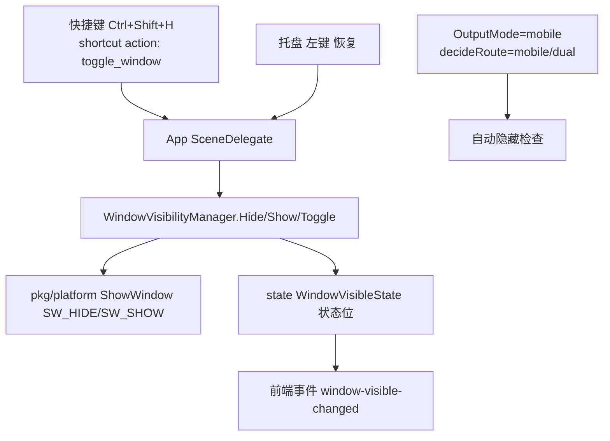

# 实施计划 — 02 · 003-desktop-window-toggle

> 设计阶段（本文件描述「将如何实现」，后续 03/04/05/06 在本目录推进）。
> 依据：`00-request.md`（需求与验收）+ `01-current-state.md`（现状）+ `_dev/audits/003`（F-101~F-110）。

## 1. 目标架构总览

新增 **WindowVisibilityManager**（窗口可见性管理器），提供 `Hide() / Show() / Toggle() / State()`，把「窗口实体隐藏」接入两类触发：**手动快捷键 `Ctrl+Shift+H`（可配置）** + **OutputMode=mobile 时自动隐藏**。隐藏后经**系统托盘图标**恢复。

```
Trigger ──► WindowVisibilityManager ──► platform(tray/ShowWindow) ──► Win32 HWND
  (shortcut/      │
  mobile路由)     └─► state：WindowVisibleState 独立存储（不并入 Ghost/OutputMode）
```



## 2. 状态模型（核心原则：三态独立存储）

| 状态 | 归属 | 存储位置 | 说明 |
|---|---|---|---|
| **GhostModeState** | pkg/state 现有 `StealthMode` | `windowState.StealthMode` | 防录屏隐身（F9），003 **不修改** |
| **WindowVisibleState** | **003 新增** | `pkg/state` 新增字段 `Visible`（布尔，默认 true） | 实体隐藏/显示，003 引入 |
| **OutputModeState** | config（现有 `OutputMode`） | 现有 | desktop/mobile/dual，003 不新增状态，仅读取 |

**关键约束（源自 D-003-004 / F-109）**：三个状态**互不合并、互不清除**。隐藏时 `GhostModeState` 与 `OutputModeState` 原样保留。

## 3. 新增模块设计

### 3.1 `pkg/state`：新增 `WindowVisibilityManager`

```
WindowVisibilityManager
├── Hide()      → platform.ShowWindow(hwnd, SW_HIDE)；置 VisibleWindowVisible=false
├── Show()      → platform.ShowWindow(hwnd, SW_SHOW)；置 true
├── Toggle()    → VisibleWindowVisible ? Hide() : Show()
├── State()     → VisibleWindowVisible
├── SetMobileAutoHide(bool)  ← 003 mobile 集成用（可选）
└── RegisterVisibilityHook(func(visible bool))  ← 前端事件推送
```

- **与 `ToggleVisibility`（现有防录屏隐身）完全解耦**：不调用、不互相清除。
- **线程安全**：复用现有 `windowMu`。

### 3.2 `pkg/platform`（Windows）：新增 Win32 封装

| 封装 | Win32 调用 | 说明 |
|---|---|---|
| `ShowWindow(hwnd, cmdShow)` | `ShowWindow(SW_HIDE/SW_SHOW)` | 实体隐藏/显示 |
| `ShowWindowAsync`（可选） | `ShowWindowAsync` | 异步，避免阻塞 UI 线程 |
| 任务栏隐藏附加 | 设置 `WS_EX_TOOLWINDOW`（已有 `SetWindowToolWindow` 可复用） | 实体隐藏时连任务栏入口一并消失（D-003-002=C） |
| `SysTrayIcon`（托盘） | `Shell_NotifyIcon(NIM_ADD/NIM_MODIFY/NIM_DELETE)` | 托盘图标创建/更新/删除（Phase 3） |
| 托盘左键回调 / 右键菜单 | `WM_USER + x` 消息 + 模态菜单 | 左键恢复 / 右键菜单（含退出） |

> 约束（00-request §4）：**不引入第三方托盘库**，用 Windows 原生 `Shell_NotifyIcon` 实现；图标可用内嵌资源或窗口内 HICON 生成。

### 3.3 `pkg/shortcut`：新增 action

- 新增 action 常量：`ActionToggleWindow`（toggle_window）。
- 在 `Manager` 现有 action 触发表中注册，挂 `Ctrl+Shift+H`（可配置，默认值见 §5）。
- 复用现有录制体系（D-003-008）：前端设置面板可录制覆盖。
- **行为**：窗口隐藏后，`Manager` 的 `WH_KEYBOARD_LL`/`WH_MOUSE_LL` 钩子依旧生效（因进程存活低层钩子独立于窗口消息循环，见审计 F-103），所以 `Ctrl+Shift+H` 在隐藏态再次触发仍能恢复。

### 3.4 `app`：新增绑定方法

```go
func (a *App) HideWindow() bool
func (a *App) ShowWindow() bool
func (a *App) ToggleWindowVisible() (bool /*新visible*/, error)
func (a *App) WindowVisible() bool   // 供前端查询
```

- 监听 `state` 的 `window-visible` 事件 → `a.EmitEvent("window-visible", ...)` 推送前端。
- **生命周期联动**：`ToggleWindow` 仅在确认窗口已获得 HWND 后才调用 platform（HWND 可能为空时返回 error）。

### 3.5 `frontend`：设置面板

- `SettingsModal.vue`（可新增「窗口」分组）：
  - 「隐藏快捷键」录制入口（复用现有 `StartRecordingKey` binding）。
  - 切换开关映射 OutputMode（现有单选已足够，不新增）。

## 4. 触发流程（严格对应需求 ④ + ⑥）

### 4.1 手工快捷键触发链

```
用户按 Ctrl+Shift+H
  → shortcut.Manager 全局钩子命中
  → onKeysChanged → handleTrigger(ActionToggleWindow)
  → app.ShortcutDelegate（分派 action）
  → app.ToggleWindowVisible()
  → state.WindowVisibility.Toggle()
  → platform.ShowWindow(SW_HIDE 或 SW_SHOW)   // Windows 层实体隐藏/恢复
  → 事件 "window-visible" → 前端同步
```

### 4.2 mobile 自动隐藏触发链

```
App.Startup
  → load config (OutputMode)
  → setupMobile() 启动 SSE goroutine（不依赖窗口可见性）
  → 若 OutputMode==mobile 或 dual 且 mobile server 可用
       → 调用 WindowVisibility.Hide()
  → 保持 SSE goroutine 存活（隐藏 ≠ 退出）
```

- **恢复**：切回 OutputMode==desktop → `WindowVisibility.Show()`。
- **约束**：`OutputMode` 读取在 `pkg/mobile/Out模式` 之外，不修改 `pkg/mobile`（SSE 协议/Bridge/LLM/Solve/Prompt 一律不动）。

### 4.3 托盘恢复链

```
用户左键托盘图标
  → SysTrayIcon 消息回调 (WM_LBUTTONDOWN)
  → app.ToggleWindowVisible() / app.ShowWindow()
```

右键菜单：`显示主窗口` / `退出`（退出走现有 `OnShutdown`）。

## 5. 键位默认

| Action | 默认键 | 备注 |
|---|---|---|
| toggle_window | `Ctrl+Shift+H` | 避开 F8-10、Ctrl+J/D、Alt+组合；可设置面板录制覆盖 |

- 冲突检查：复用 `handleRecordingComplete` 内部冲突检测；若命中系统热键（不符合 `shortcut` 现有 `ReservedKey` 规则）则提示改键。

## 6. 任务栏 / 托盘策略（D-002）

- **隐藏时**：`ShowWindow(SW_HIDE)` 本身即移除任务栏按钮，额外执行 `SetWindowToolWindow` 保证全局一致性。
- **显示恢复时**：`ShowWindow(SW_SHOW)` + `SetWindowLong(GWL_STYLE, WS_EX_TOOLWINDOW)` 取舍决定：恢复后**不显示任务栏入口**（保持 tool window），仅托盘恢复。
- **每次窗口状态变更**：托盘图标存在（D-003-002），左键恢复、右键菜单含退出。

## 7. Phase 计划

| Phase | 内容 | 产出 | 验证 |
|---|---|---|---|
| **Phase 1** | WindowVisibilityManager + `pkg/state` 三态分离 + `pkg/platform` ShowWindow + app 绑定 Hide/Show/Toggle/State | 窗口实体隐藏/显示可用（可用快捷键或临时绑定测试） | 手测：隐藏后进程存活、SSE 案例通过 |
| **Phase 2** | shortcut action `toggle_window` + 默认键 `Ctrl+Shift+H` + 设置面板录制 | 快捷键触发隐藏/恢复 | `go build` + 前端测试 |
| **Phase 3** | 托盘图标（原生 Shell_NotifyIcon）+ 左键恢复 + 右键菜单（恢复/退出） | 托盘恢复入口 | 手测托盘行为 |
| **Phase 4** | OutputMode=mobile/dual 自动隐藏 + 切回 desktop 自动恢复 + 事件同步 | 移动集成完成 | 全量验证（见 `04-validation`） |

> Phase 顺序依赖：Phase1 → Phase2（机关快捷键）→ Phase3（托盘支撑恢复）→ Phase4（mobile 联动完整闭环）。

## 8. 测试计划

- **单元测试**（`pkg/state`、`pkg/shortcut`）：
  - `Toggle()` 状态机：可见↔隐藏往返，Ghost/OutputMode 不变（间接）。
  - `WindowVisibility` State 的并发读写（race detector）。
- **集成**：`go build ./...`、`go vet`、`go test ./app/... ./pkg/...`。
- **手工验收**：按 00-request §3 逐条核对。

## 9. 风险与对策（能追溯到 F-）

| F-编号 | 风险 | 对策（设计层面） |
|---|---|---|
| F-101 | 实体隐藏从零引入 | Phase1 即完成 platform.ShowWindow 封装最小闭环 |
| F-102 | 隐藏/隐身/最小化语义不清晰 | 状态三态独立，前端文字明确区分 |
| F-103 | 隐藏后可恢复 | hook 不依赖窗口 → 隐藏后快捷键仍工作（代码层面 001 保留） |
| F-104 | mobile SSE 解耦 | 不触碰 `pkg/mobile` |
| F-105 | 恢复路径缺失 | 托盘图标 + 快捷键双恢复 |
| F-106 | 键位冲突 | 默认避开已占用，录制冲突检测复用 |
| F-108 | 双窗口疑点 | 枚举 `GetWindowHandle`，隐藏主窗口 + 连带 WebView 子窗口（验证阶段确认） |
| F-109 | 状态事件一致性 | 增加窗口-visible 事件，前端同步 |

## 10. 非目标（重复 00-request 声明）

- 不做 mobile 远程唤醒、不做 macOS、不做「最小化到托盘」语义、不修改 SSE/Bridge/LLM/Solve/Prompt/GhostMode，不新增依赖。